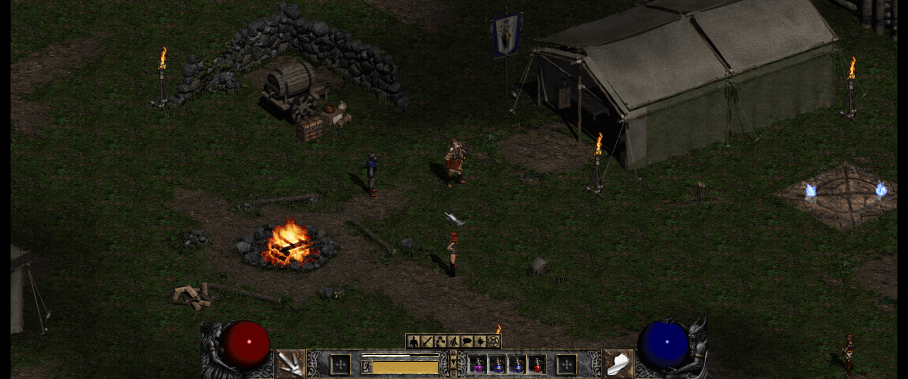
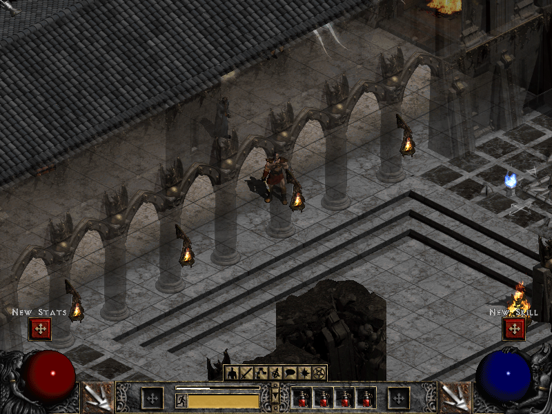
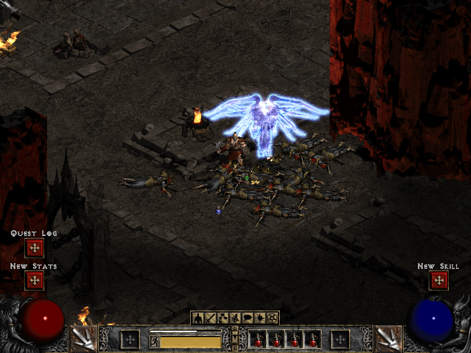
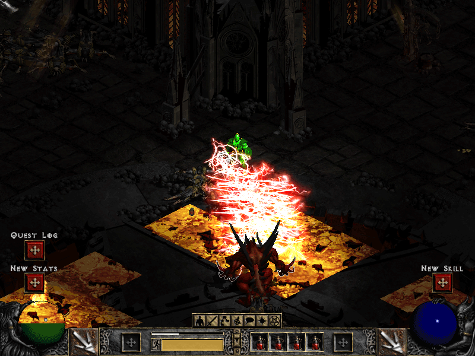
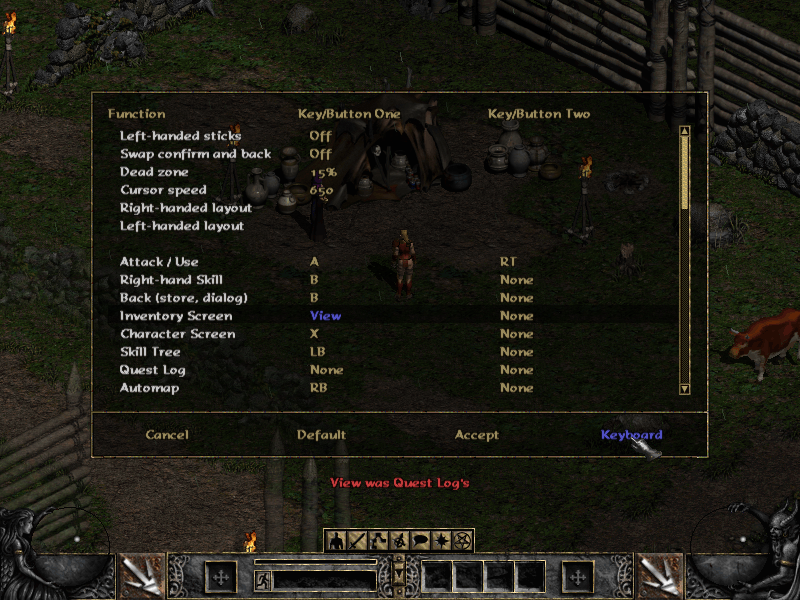
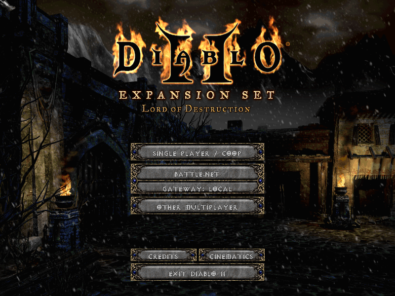
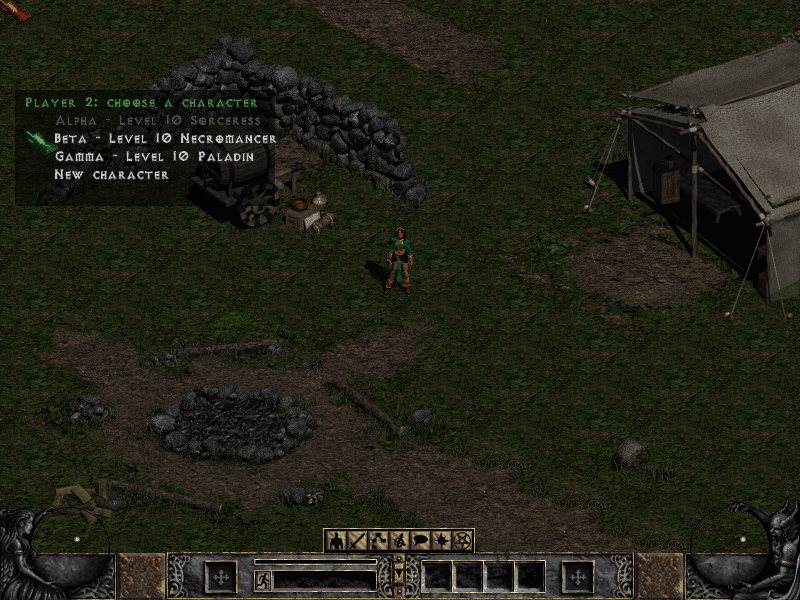
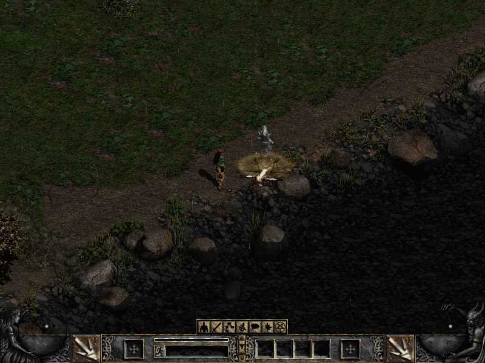
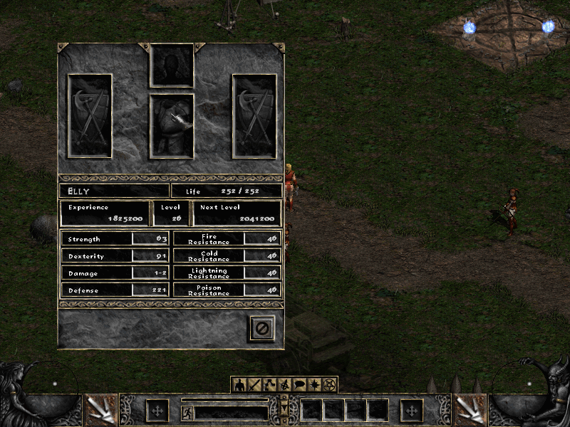
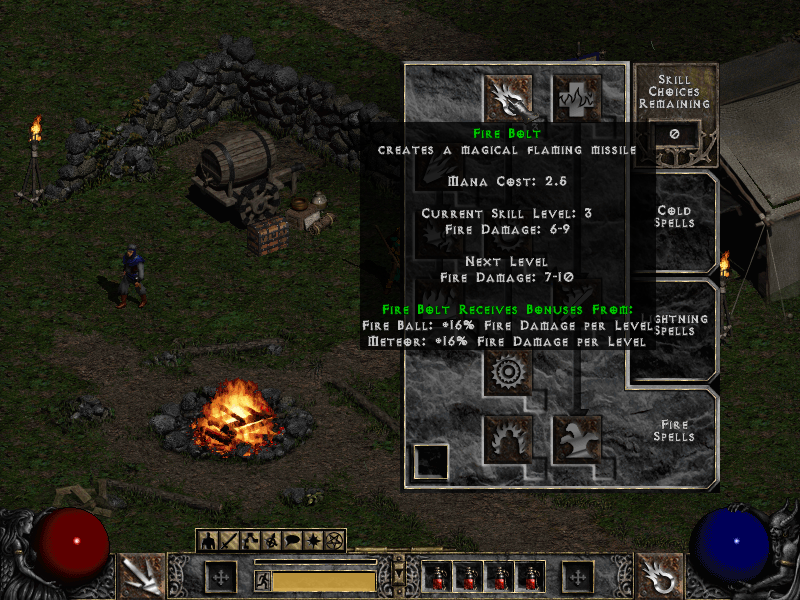

# D2Decomp: Act IV, widescreen and couch co-op

It has been a busy week since the [last post](2026-10-16-d2decomp-playing-diablo-ii-natively.md). Roughly two hundred commits and a run of releases from v0.3.0 to v0.5.6 later, [D2Decomp](../../projects/d2decomp.md "D2Decomp") has grown in a direction that matters most to me: playing together.

The screenshot above is the Rogue Encampment with the new widescreen view, running at 3440×1440. More on that below.

## Act IV and Diablo

Last time, the hellgate in Act III opened onto nothing. Now it leads to the Pandemonium Fortress. All six Act IV levels match the original, from the Outer Steppes through the River of Flame to the Chaos Sanctuary. The three Act IV quests are in: Izual, the Hellforge and Terror's End.

{ width="600" }

{ width="600" }

Diablo himself took the most work. His choice of what to do next, his Run, Bone Wall and Bone Prison, the seals and the knights guarding them have all been traced in the original and checked against it. A classic game ends with Diablo's death and the ending sequence. In Lord of Destruction, Tyrael's portal leads to Act V, which is not built yet.

{ width="600" }

That makes Acts I to IV, all twenty-one quests up to Diablo. Nightmare and Hell also place their monsters and objects as the original does, on every level of the first four acts.

## Widescreen

Widescreen is an opt-in improvement, turned on from the launcher or with `widescreen = 1` in `d2d.cfg`. The game view widens to fit the window, up to 1400 pixels wide, so you see more of the world to the left and right. The HUD and panels keep their familiar 800×600 layout in the middle, and menus and cinematics stay at 800×600.

It is off by default, because D2Decomp's job is to play like the original first.

## Gamepads and the Steam Deck

D2Decomp now plays with a gamepad as well as with mouse and keyboard. Xbox, PlayStation, Switch and Steam Deck controllers work, with button labels to match each one. The left stick walks, the right stick aims, and ranged skills and spells lock on to the nearest target. The d-pad moves between slots in the inventory, stash and stores. There is also a Configure Controls screen, like the original's key configuration, with an extra page for the pad.

{ width="600" }

The Steam Deck build is a Flatpak, attached to every release. It is still experimental and not on Flathub yet. The launcher has an **Add to Steam** button that adds the game to your library with its artwork, and in Gaming Mode the launcher is skipped so you go straight into the game. Steam's on-screen keyboard opens when you need to type, for example to name a character.

## Couch co-op

This is the part I am most excited about. Up to four players can now play together on one screen, from one machine, with no original game running. The idea is a docked Steam Deck with a few controllers, my daughter on one of them, but any PC or Mac with pads works the same way.

From the title screen, choose COOP. Each pad gets its own player, who picks or creates a character from a roster. A pad that connects mid-game can join right away. The party shares one camera and a leash keeps everyone together. Monsters scale with the number of players, and experience, gold and quests are shared by the same rules as an original multiplayer game.

{ width="600" }

{ width="600" }

Dying works a little differently from the original. A fallen player becomes a ghost next to their body, and the others can channel a Resurrect skill to bring them back. More players channelling means a quicker resurrection. There was never a couch in Diablo II, so this is one of the places where D2Decomp adds something of its own.

{ width="600" }

Joining a game hosted by the original game over TCP/IP has also moved on. Acts I to IV have now been played through together with an original host: party, trade, portals, waypoints, chat, quests and travel.

## Sound, screens and smaller things

Sound has come a long way. 3,123 of the base game's 3,520 sounds play as the original plays them: combat, spells, missiles, footsteps, monsters, objects and NPC greetings. Sounds in the world fade with distance and pan between the speakers as in the original, and items make their sounds when you pick them up, place them or equip them. The hero's quest lines are next.

A number of screens arrived too: the Party screen, the Hireling screen for your mercenary's gear, the Help screen, automap options and skill tooltips, all drawn the way the original draws them. You can now drop, deposit and withdraw gold, and use the weapon switch.

{ width="600" }

{ width="600" }

## Keeping it honest

The less visible work continues as well. The opt-in crash reporting from last time has already paid for itself: a handful of crashes reported by testers were found and fixed within a day. The project is now also scanned by [Coverity](https://scan.coverity.com/), and a fair amount of this week went into working through what it found.

## What's next

Act V, hosting multiplayer games from d2d itself, and a dedicated server are still ahead of us. The [source, releases and roadmap](https://github.com/psi29a/d2decomped) are on GitHub. As before, D2Decomp does not include any game files; you need your own copy of Diablo II and Lord of Destruction.
