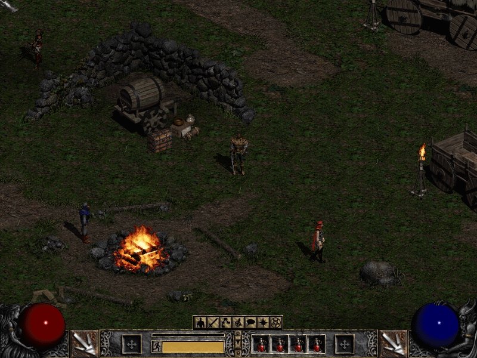
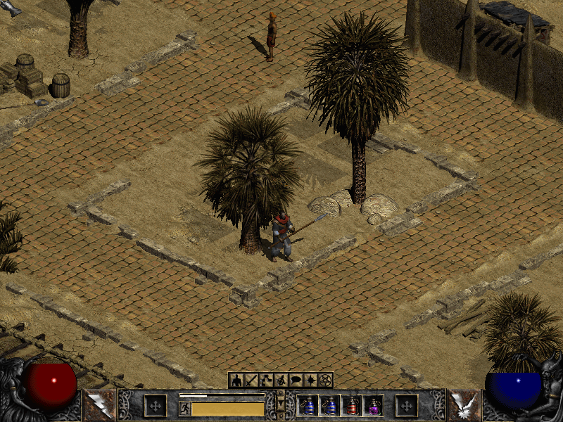
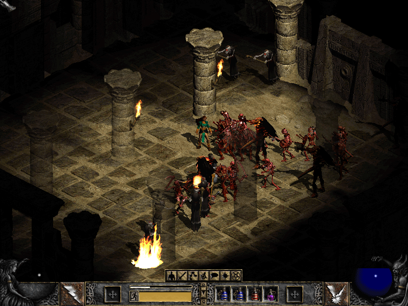
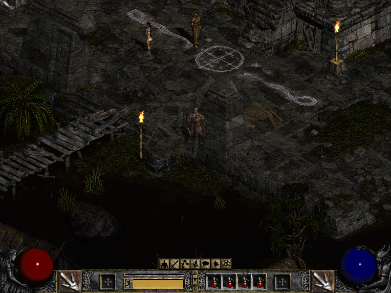
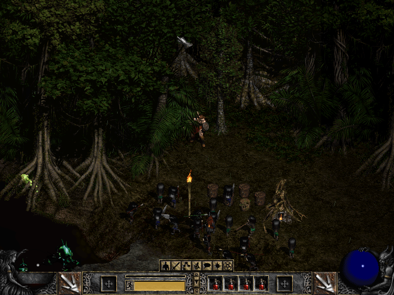
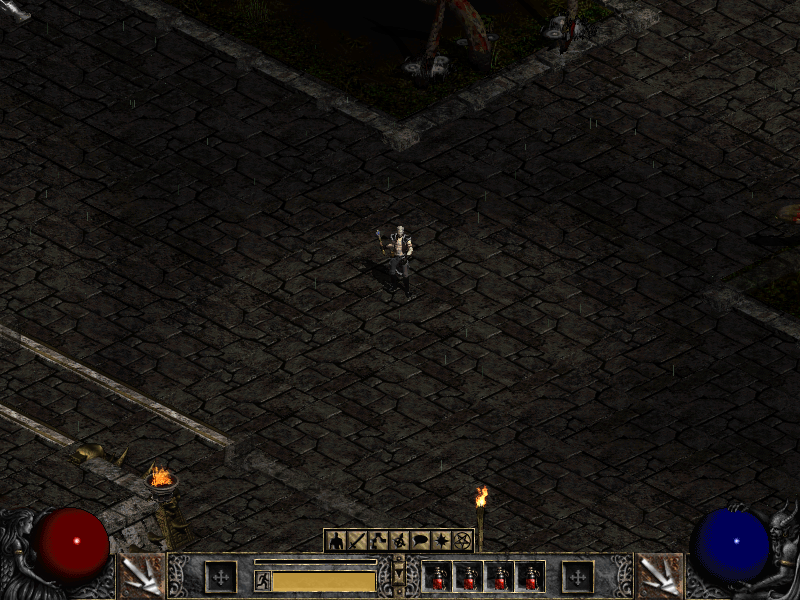
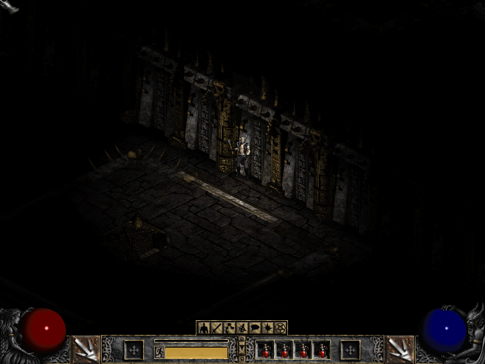

# D2Decomp: A Diablo II Engine Reimplementation

**D2Decomp** is a cross-platform, open-source reimplementation of the Diablo II: Lord of Destruction game engine. It uses version 1.14d as its reference and aims to become a drop-in replacement, with a few optional features beyond the original.

I want to play Diablo II with my daughter, natively on Linux. No Wine, no emulation layer: a game engine that runs on our machines, reads the game data we own, and lets us adventure together.

**[Download the latest release](https://github.com/psi29a/d2decomped/releases/latest)** for Linux, Windows, macOS and the Steam Deck. You will need your own copy of Diablo II and Lord of Destruction.

## Where it is now

D2Decomp is unfinished, but Acts I to IV play through: character setup, the Rogue Encampment, Lut Gholein, the Kurast Docks and the Pandemonium Fortress, every area from the Blood Moor to the Chaos Sanctuary, and all twenty-one quests up to Diablo's death. A classic game ends there. In Lord of Destruction, Tyrael's portal leads to Act V, which is not built yet.

- The 39 Act I, 35 Act II, 28 Act III and 6 Act IV levels have maps that match the original.
- Monster and object placement and monster AI, Diablo included, have been checked against the original. There are still a few details to match.
- Nightmare and Hell place their monsters and objects as the original does, on every level of Acts I to IV.
- Single player, softcore and hardcore, runs as a one-player client/server, like the original.
- Up to four players can play together on one screen with gamepads (local co-op).
- d2d can join a game hosted by the original game over TCP/IP. Acts I to IV have been played through together: party, trade, portals, waypoints, chat, quests and travel. A few live checks are still pending.
- 3,123 of the base game's 3,520 sounds play as the original plays them.

## How it works

[Ghidra](https://github.com/NationalSecurityAgency/ghidra) helps us understand the original game's code. [Unicorn](https://www.unicorn-engine.org/) runs original game functions so we can check that this reimplementation behaves the same way. The engine itself is new code, written in modern C++.

The project runs on Linux, Windows and macOS, and on the Steam Deck. It also has an optional headless mode and a local control channel for scripted play and testing.

## Beyond the original game

- **Local co-op:** up to four players on one screen, each with their own gamepad, sharing one camera. A fallen player becomes a ghost, and the others can channel a Resurrect skill to bring them back.
- **Gamepads:** Xbox, PlayStation, Switch and Steam Deck controllers, with a gamepad page in Configure Controls.
- **Widescreen:** an opt-in wider game view that shows more of the world to the left and right. The HUD and panels keep their 800×600 layout, and menus and cinematics stay at 800×600.
- **Steam Deck:** an experimental Flatpak with every release. The launcher's **Add to Steam** button adds the game to your Steam library with its artwork, so it launches from Gaming Mode.
- **Small comforts,** each of which can be turned off: gold is picked up when you walk over it, roofs turn see-through around your character, and the world's sounds pause with the game menu.
- **Opt-in crash reporting,** off by default. When enabled, a crash report may include a crash dump, hardware and OS details, the GPU model and the last game frame; it is sent only if the game crashes. The launcher explains what is sent and notes that the report may contain sensitive data from the game's memory.

## Screenshots

### Act I

### Act II

### Act III

### Act IV

### Local co-op

## Bring your own game

D2Decomp does not include Diablo II or its game data. You need your own Diablo II + Lord of Destruction installation or media. The project is not affiliated with or endorsed by Blizzard Entertainment.

## What's next

Act V, hosting multiplayer games from d2d itself, and a dedicated server.

## Links

- [Source code and build instructions](https://github.com/psi29a/d2decomped)
- [Releases](https://github.com/psi29a/d2decomped/releases)
- [Issues](https://github.com/psi29a/d2decomped/issues)
- [Full roadmap](https://github.com/psi29a/d2decomped/blob/main/docs/PLAN.md)
- Blog: [Playing Diablo II natively on Linux](../blog/posts/2026-10-16-d2decomp-playing-diablo-ii-natively.md)
- Blog: [Act IV, widescreen and couch co-op](../blog/posts/2026-10-24-d2decomp-act-iv-widescreen-and-couch-co-op.md)
